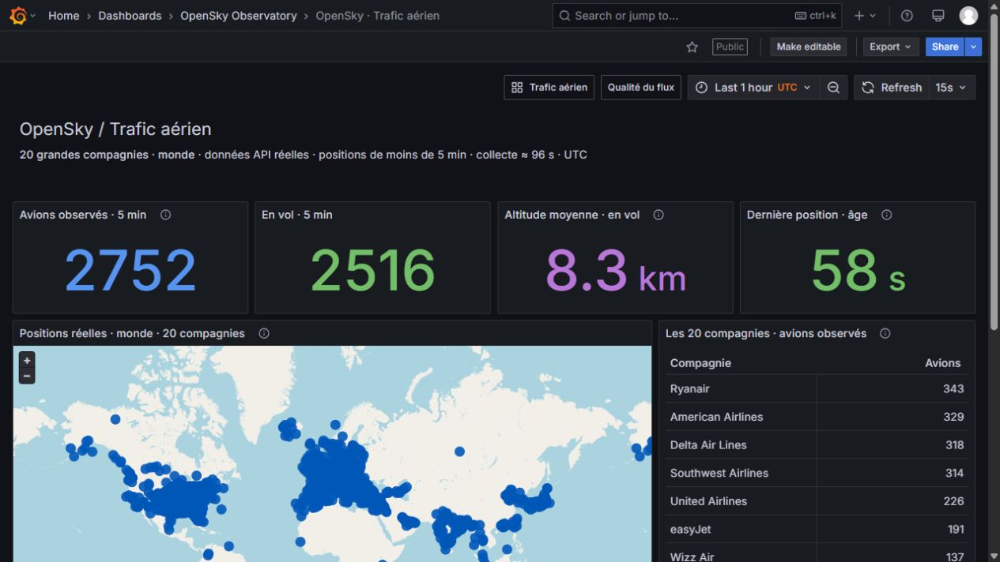
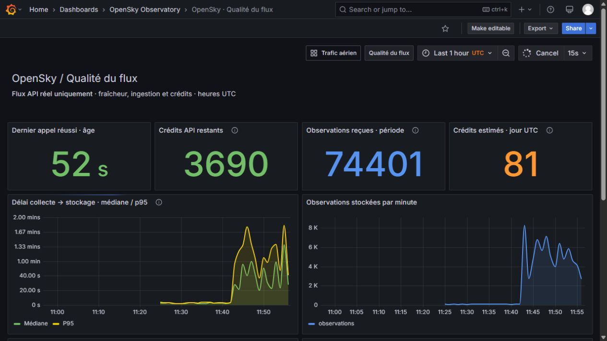
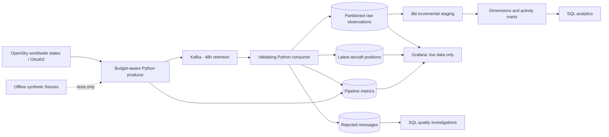

# OpenSky Observatory

**A worldwide aircraft-data pipeline with a live observatory for 20 major airlines.**

Python · Apache Kafka · PostgreSQL · dbt · Grafana · Docker Compose

OpenSky → Kafka → Python → PostgreSQL → dbt → Grafana. The project ingests aircraft
positions, quarantines invalid records, handles retries safely, and exposes both
airspace activity and pipeline health. Grafana displays **real OpenSky data only**.
A synthetic source remains available for offline ingestion and CI tests.



**Explore:** [Dashboard gallery](docs/dashboards.md) · [Architecture](#architecture) ·
[Operations runbook](docs/runbook.md) · [Portfolio case study](docs/portfolio.md) ·
[Validation evidence](docs/validation.md)

The traffic dashboard shows recent OpenSky positions for a fixed selection of
20 major airlines. The health dashboard follows the entire worldwide ingestion.
Screenshots are from the local deployment on **9 October 2026 (UTC)**; their counts
are observations at capture time, not fleet sizes or performance benchmarks.

**Validated locally:** 42 Python tests passed with Kafka/PostgreSQL, 22 dbt build nodes
passed, and all 18 dashboard queries executed successfully. [Details](docs/validation.md).

## Start locally

Install Docker Desktop with Linux containers and allow roughly 4 GB of memory.
The first run downloads container images and can take several minutes.

**Windows PowerShell**

```powershell
git clone https://github.com/Yassine-Ben-Terras/flight-data-pipeline.git
cd flight-data-pipeline
.\scripts\setup.ps1 -CredentialsPath "$env:USERPROFILE\Downloads\credentials.json"
```

**Linux / macOS**

```bash
git clone https://github.com/Yassine-Ben-Terras/flight-data-pipeline.git
cd flight-data-pipeline
cp .env.example .env
mkdir -p .secrets
# Copy your OpenSky credentials to .secrets/opensky.json before starting.
docker compose up -d --build
```

Open [Trafic aérien](http://localhost:3000/d/flight-operations) or
[Qualité du flux](http://localhost:3000/d/pipeline-health).
Username: `admin`. Password: `GRAFANA_PASSWORD` in `.env`
(default local development password: `local-dashboard-password`).
Allow up to five minutes for the first populated dbt models.

The default coverage is **worldwide** (`OPENSKY_COVERAGE=global`) and the source is
**live** (`SOURCE_MODE=live`). For an existing installation, set both values in `.env`, then run:

```bash
docker compose up -d producer
```

OpenSky credentials use `clientId` and `clientSecret` JSON fields. They are mounted
read-only into the producer from `.secrets/opensky.json`, excluded from Git and
Docker build contexts, and never printed. Environment variables
`OPENSKY_CLIENT_ID` / `OPENSKY_CLIENT_SECRET` are also supported by the Python client.
Every dashboard query filters `source='live'`, including historical charts and
API-health panels. Demo labels, counters, rows, and points are excluded from the
interface. Existing synthetic records are preserved in the warehouse for tests;
they cannot appear in the provisioned dashboards. `SOURCE_MODE=demo` remains
available for offline tests, but will not populate the live-only dashboards.

Dashboard source: `scripts/build_dashboards.py`. Run `python -m scripts.build_dashboards`
after editing it; this regenerates dashboard JSON and the shared dbt airline seed.
Grafana reloads the JSON through file provisioning; rebuild dbt after seed changes.

## Dashboard scope

The fixed selection follows [OAG Takeoff 2025](https://www.oag.com/worlds-major-airlines).
It is a selection of major airlines, not an absolute ranking by fleet size.

| Americas | Europe | Asia and Middle East |
|---|---|---|
| Air Canada | British Airways | Air China |
| Alaska Airlines | easyJet | All Nippon Airways |
| American Airlines | Lufthansa | China Eastern |
| Delta Air Lines | Ryanair | China Southern |
| LATAM Airlines | Turkish Airlines | Emirates |
| Southwest Airlines | Wizz Air | IndiGo |
| United Airlines | | Qatar Airways |

The reference lives in [`grafana/airlines.json`](grafana/airlines.json), with ICAO
prefixes checked against the [FAA directory](https://www.faa.gov/air_traffic/publications/atpubs/cnt_html/chap3_section_3.html).
Known easyJet, LATAM and Wizz prefixes are grouped. Subsidiary coverage is not exhaustive;
missing or unusual callsigns cannot reliably identify an operator.

The map has no SQL row limit and shows positions under five minutes old.
The airline table always includes all 20 names: zero means no recent observation,
not an empty fleet. OpenSky coverage varies by receiver availability.



See the [full gallery](docs/dashboards.md) for the map, traffic analytics and API credits.

## Architecture



There are seven long-running services: Kafka, PostgreSQL, producer, consumer,
maintenance, dbt runner, and Grafana. Topic initialization is a one-shot service.
Only Grafana is exposed on the host, bound to `127.0.0.1:3000`.

## What this demonstrates

| Engineering problem | Implementation |
|---|---|
| Ephemeral source | Kafka buffers snapshots for 48 hours while the sink is unavailable |
| Duplicate delivery | Raw primary key `(icao24, position_at)`; message-offset registry protects metrics/rejects |
| Out-of-order messages | Current-state upsert only accepts a newer position |
| Atomic loading | Raw, current, rejects, registry, and batch metrics commit in one PostgreSQL transaction |
| Safe acknowledgment | Kafka offsets commit synchronously after the database commit |
| Bad input | Original message and rejection reason retained for inspection |
| Incremental ELT | dbt inserts unseen observation keys and prunes expired staging records |
| Observability | Live map, airline counts, latency, throughput, freshness, API credits; lag/rejects in logs and SQL |
| Recovery confidence | Real Kafka/PostgreSQL integration test includes forced rollback and replay |
| Reproducibility | Docker Compose provisioning, demo data, tests, and GitHub Actions |

## Data contract

The source's complete 17- or 18-field state vector is stored unchanged in `payload`.
Selected fields are typed for SQL. Times are UTC, altitude is meters, and velocity
is meters per second. `position_at` is the UTC conversion of `time_position`.
Daily range partitioning on this exact timestamp permits a PostgreSQL primary key
that also gives the intended aircraft/position deduplication.

Validation rejects missing position keys, malformed ICAO hex identifiers,
non-finite/out-of-range coordinates, altitude outside −500–20,000 m, velocity
outside 0–350 m/s, invalid boolean/type fields, observations older than raw
retention, and positions over five minutes in the future. Null optional altitude
and velocity are allowed. Records without positions are quarantined rather than
being interpreted as corrupt aircraft; this pipeline specifically serves a map.

The dbt models are:

| Model | Grain / meaning |
|---|---|
| `stg_flight_states` | One aircraft-position timestamp; typed and normalized fields |
| `dim_aircraft` | One observed ICAO identifier with first/last retained observation |
| `dim_airlines` | Curated callsign-prefix reference, including dashboard airlines and unknown fallback |
| `mart_daily_flight_activity` | Day × source × inferred airline; observations and distinct aircraft |
| `mart_active_flights` | Minute × source; distinct observed airborne/ground aircraft |

The aircraft dimension is derived from observations, **not an authoritative aircraft
registry**. The airline reference is curated and callsign inference is a
heuristic. Counts measure aircraft observations, **not completed flights or routes**.
Unmatched airline prefixes map to `UNK` rather than failing ingestion.

The staging incremental query anti-joins retained raw keys instead of using a
strict `max(ingested_at)` watermark: an earlier-started transaction committing late
cannot be skipped. This intentionally trades some scan cost for correctness at a
portfolio scale. Worldwide retention increases scan and storage costs; sustained
volume needs measurement and tuning. Marts are views over staging, so their freshness
is governed by the five-minute dbt build interval. The live traffic panels query
current/raw tables directly; they do not wait for a dbt refresh.

## API budget and limitations

A worldwide request costs an estimated **4 credits**. The interval is
`ceil(86400 × estimated_request_cost / daily_budget)`, with a five-second minimum.
The default budget of **3,600 credits/day** therefore yields **96 seconds**.
The 15-second dashboard refresh reads PostgreSQL and does not call OpenSky.
For regional mode, the supplied 20-square-degree Morocco/Gibraltar box costs
an estimated one credit per request (24 seconds at the same budget).
Costs are estimated locally; remaining credits are taken from response headers.
Rate-limit responses honor the server's retry delay, with bounded exponential
backoff as a fallback. OAuth tokens refresh before expiry and after a 401 response.

These behaviors were checked against the [official OpenSky API documentation](https://openskynetwork.github.io/opensky-api/rest.html)
and [OAuth guidance](https://opensky-network.org/about/faq).
Authenticated state queries have a limited historical window, but this project
does not implement historical backfill. API outages and failed polls leave visible
gaps. Review OpenSky's applicable [data-use terms](https://opensky-network.org/about/terms-of-use)
before hosting a public or operational deployment; the repository's synthetic demo
does not require publishing OpenSky records.

**Guarantees have boundaries.** A single broker and database do not survive node or
disk loss. Data is durable only after Kafka acknowledges it; a producer crash between
the HTTP response and that acknowledgment can lose a source snapshot. Producer
health metrics are a separate best-effort write after Kafka delivery, so they are
not atomic with publication. Consumer sink writes are atomic. Offset-registry
retention is three days, exceeding the default two-day Kafka window; manual replay
from other archives can change processing metrics after that registry expires.

## Retention and operations

| Data | Default |
|---|---|
| Kafka | 48 hours |
| Raw daily partitions and rejected messages | 14 days (partition expiry at day granularity) |
| Incremental dbt staging | Same configured day window, pruned on build |
| Latest aircraft state | 24 hours; map displays only last 5 minutes |
| Metrics | 30 days |
| Processed-message registry | 3 days |

Maintenance runs hourly. Changes to PostgreSQL init scripts only apply automatically
to a new volume; use explicit migrations for an existing warehouse. This local
portfolio stack uses the bootstrap database role for loading/modeling. Grafana has
a separate SELECT-only role. Production deployment would also need role separation,
TLS, secret management, backups, replication, and dependency/security updates.

```bash
docker compose logs -f --tail 50 producer consumer dbt-runner
docker compose --profile test run --rm tests
docker compose stop dbt-runner
docker compose run --rm --no-deps dbt-runner dbt build
docker compose run --rm --no-deps dbt-runner dbt source freshness
docker compose start dbt-runner
docker compose down               # keeps data volumes
```

Stop the dbt loop before manual builds to avoid concurrent model writes.
See [the runbook](docs/runbook.md) for replay, recovery, API checks, and measurement.

## Portfolio presentation

Start with the live map, switch to pipeline health, and explain the atomic sink and
replay test. Then show the dbt DAG and discuss the anti-join incremental strategy.
See [the case study](docs/portfolio.md) for a five-minute walkthrough and honest
resume wording. Performance claims must come from measured runs; this project
does not fabricate throughput, uptime, or 24-hour percentiles.

## Repository

```text
app/                         Python ingestion, validation, OAuth, maintenance
postgres/                    Partitioned warehouse schema and reader role
dbt_project/flight_analytics/ Models, seeds, and data tests
dbt-runner/                  Scheduled dbt build and freshness checks
grafana/                     Provisioned dashboards and PostgreSQL datasource
tests/                       Unit and real-service integration tests
scripts/                     Windows setup and safe API check
docs/                        Runbook, portfolio narrative, validation evidence
.github/workflows/ci.yml      Demo-based CI (no API secrets required)
```
