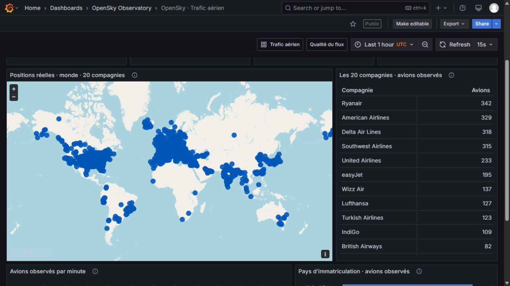
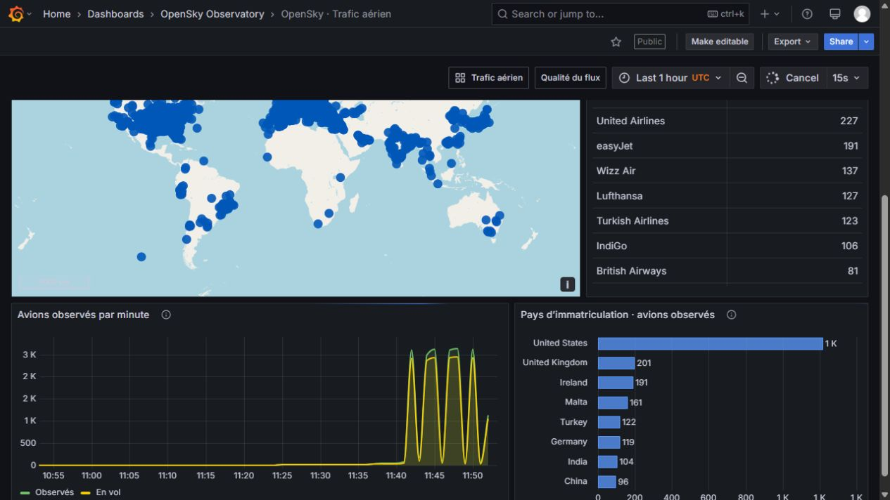
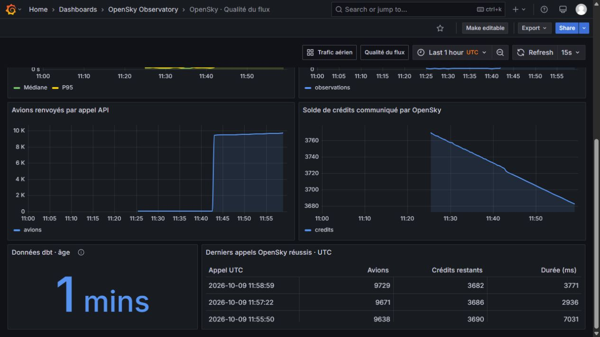

# Grafana dashboard gallery

Real screenshots from the local OpenSky deployment, captured on **9 October 2026 (UTC)**.
The UI is in French. Both dashboards refresh every 15 seconds from PostgreSQL;
OpenSky is polled approximately every 96 seconds with the default global budget.
Counts change between captures and are not a total-fleet inventory.

## 1. Worldwide traffic overview

The four indicators show recent observed aircraft, airborne aircraft, average
barometric altitude of airborne aircraft, and the age of the latest position.
Only the fixed 20-airline selection and real API positions under five minutes old
contribute to these indicators.

## 2. World map and airline breakdown

The map contains one recent position per aircraft, without a SQL row limit.
The table groups the configured callsign prefixes into 20 airline names, including
zero-observation groups. Scroll the table to inspect all companies. The basemap is
OpenStreetMap, using Grafana's `osm-standard` layer without a CARTO API key.

## 3. Traffic analytics

The lower panels compare distinct observed/airborne aircraft by position minute
and the leading registration countries within the selected airlines. Registration
country is different from the aircraft's current location.

The visible jump corresponds to the switch from regional to worldwide collection.
The 96-second polling cadence and varying position timestamps affect minute buckets;
this is an observation chart, not a continuous measure of all flights in the sky.

## 4. Pipeline freshness, latency and throughput

This dashboard measures **the entire worldwide API ingestion**, including operators
outside the 20-airline selection. Its observation counts therefore exceed the traffic
view. Latency is measured from the poll response to PostgreSQL ingestion; it is not
the age of the aircraft's last radio transmission.

## 5. API credit budget and recent polls

The lower panels show states returned per API call, the reported credit balance,
dbt data age, and the latest successful calls. Estimated daily consumption and the
server-reported balance have different meanings. Earlier regional polls remain
visible until they leave the selected time range.

## Reproduce these views

1. Follow the [startup instructions](../README.md#start-locally) with your own credentials.
2. Open [traffic](http://localhost:3000/d/flight-operations) or
   [pipeline health](http://localhost:3000/d/pipeline-health).
3. Allow at least one successful API poll and consumer catch-up; dbt refreshes every five minutes.
4. Use a one-hour time range, then scroll to the lower panels.

Dashboard source: [`scripts/build_dashboards.py`](../scripts/build_dashboards.py).
Airline reference: [`grafana/airlines.json`](../grafana/airlines.json).
Troubleshooting: [runbook](runbook.md#empty-map-or-outdated-layout).
